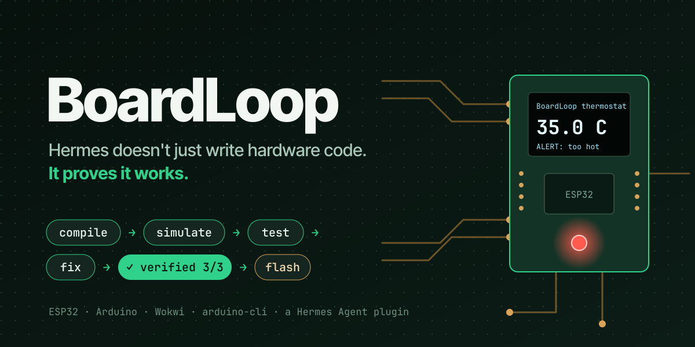
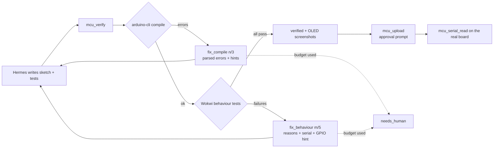
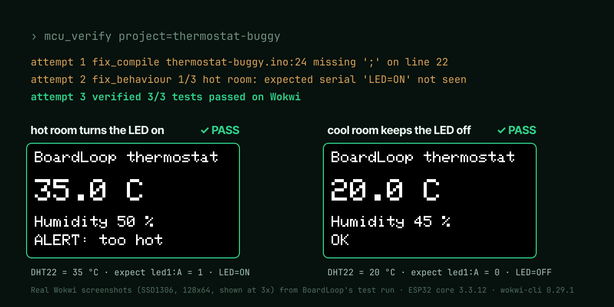

# BoardLoop

**Hermes doesn't just write hardware code. It proves it works.**

[](https://github.com/LSUDOKO/BoardLoop/actions/workflows/ci.yml)


BoardLoop is a [Hermes Agent](https://hermes-agent.nousresearch.com) plugin that gives the agent a
real embedded toolchain and a simulated workbench. Hermes writes ESP32 or Arduino firmware, then
**compiles it** with `arduino-cli`, **runs it in a virtual circuit** on the
[Wokwi](https://wokwi.com) simulator, **tests its behaviour** (sets sensor values, presses buttons,
checks LEDs, pins, serial output and OLED screenshots), **fixes its own mistakes** within bounded
attempts, and **flashes a real board** once you approve.





## Why

AI-written firmware usually fails, and the model never sees the board. Published research shows
that feedback from the hardware is what fixes this:

| Study | Finding |
|---|---|
| **EmbedAgent** (ICSE 2026, [arXiv 2506.11003](https://arxiv.org/abs/2506.11003)): 126 tasks on Arduino, ESP32, Pico | The best model passes only **55.6%**, and **29.4%** on ESP-IDF tasks. Compiler feedback improves results. |
| **EmbedGenius** ([arXiv 2412.09058](https://arxiv.org/abs/2412.09058)) | Compile → fix (max 3) → flash → read output → fix (max 5) reaches **95.7%** coding accuracy over 350+ tasks. |
| **Englhardt et al.**, UW ([arXiv 2307.03817](https://arxiv.org/abs/2307.03817)) | Hardware-in-the-loop feedback took beginners from **25% to 100%** success on a LoRa sensor task. |

BoardLoop is that loop, packaged for Hermes. The budgets in [`loop.py`](loop.py) are the
EmbedGenius ones (3 compile fixes, 5 behaviour fixes). In simulation it works for anyone, with no
hardware. With a board, it also works on the real thing.

## What it looks like

> **You:** The thermostat-buggy project is broken. Make it pass its tests.

1. `mcu_verify` → **fix_compile 1/3**: `thermostat-buggy.ino:24:1: expected ',' or ';' before 'Adafruit_SSD1306'`.
   Hint: *a statement just above this line is missing a `;`*, with line 22 shown as context.
2. Hermes adds the `;` → `mcu_verify` → **fix_behaviour 1/5** (1/3 tests passed):
   - *hot room turns the LED on*: `expected serial 'LED=ON' not seen`; the firmware printed `T=35.0 H=50.0 LED=OFF`
   - *cool room keeps the LED off*: `expected serial 'LED=OFF' not seen`
3. Hermes flips `<` to `>` → `mcu_verify` → **verified 3/3**, with OLED screenshots of each test.



This exact sequence runs in CI against the fake tools
([`tests/test_tools.py::test_the_demo_loop_fixes_the_buggy_sample`](tests/test_tools.py)) and on
the real toolchain ([`tests/test_real.py`](tests/test_real.py)).

## Tools

| Tool | What it does | Approval |
|---|---|---|
| `mcu_doctor` | Checks arduino-cli, cores, libraries, wokwi-cli, the token (never shown), pyserial, the workspace and Wokwi minutes; gives the exact fix for each gap | |
| `mcu_project_new` | Creates a project from a template: `esp32-blank` (esp32/s3/c3), `esp32-thermostat`, `uno-blink`, `demo-thermostat-buggy` | |
| `mcu_project_info` | Parts list, wiring table (`dht1:SDA → esp:4`), tests and last result, so code matches the circuit | |
| `mcu_libraries` | Search, install (and record in the project) or list Arduino libraries | |
| `mcu_compile` | Compiles; ≤10 parsed errors with source context and fix hints; flash/RAM use | |
| `mcu_simulate` | One Wokwi run: expect/fail text, serial tail, part screenshot | |
| `mcu_test` | **Behaviour tests on simulated hardware**, each in an isolated run folder; `only=[...]` reruns failures | |
| `mcu_verify` | The loop step: compile → test → one status with an attempt budget | |
| `mcu_wiring_check` | Catches input-only pins used as outputs, LEDs without resistors, buttons on strapping pins, parts without ground, plus `wokwi-cli lint` | |
| `mcu_export` | Exports the sketch, diagram and libraries for the wokwi.com editor, to watch the circuit live | |
| `mcu_ports` | Lists connected boards | |
| `mcu_upload` | Flashes a real board; the prompt shows board, port, size and **whether tests passed** | **yes** |
| `mcu_serial_read` | Reads a real board's serial output, optionally checking `expect_serial` | |
| `mcu_serial_write` | Sends a line to the board | **yes** |

Also: the **`/mcu`** command (status, projects, history, doctor), a bundled **skill** that teaches
the agent the workflow and how to write tests ([`skills/boardloop/SKILL.md`](skills/boardloop/SKILL.md)),
a **Wokwi minutes meter**, and a **Hermes Desktop card** ([`desktop/plugin.js`](desktop/plugin.js)) that
shows each simulated OLED screenshot in chat with its test name, PASS/FAIL and reason.

## Quick start

1. **arduino-cli**, the cores and the libraries ([install guide](https://arduino.github.io/arduino-cli/latest/installation/)):
   ```bash
   arduino-cli config init
   arduino-cli config add board_manager.additional_urls https://espressif.github.io/arduino-esp32/package_esp32_index.json
   arduino-cli core update-index
   arduino-cli core install esp32:esp32 arduino:avr
   arduino-cli lib install "Adafruit SSD1306" "Adafruit GFX Library" "DHT sensor library" "Adafruit Unified Sensor"
   ```
2. **wokwi-cli** ([getting started](https://docs.wokwi.com/wokwi-ci/getting-started)) and a free CI
   token from <https://wokwi.com/dashboard/ci>.
3. **The plugin:**
   ```bash
   hermes plugins install boardloop --enable            # from the catalog, once listed
   hermes plugins install LSUDOKO/BoardLoop --enable    # or straight from GitHub
   ```
4. Put the token in **Settings → Plugins → BoardLoop → Wokwi CI token** (stored as a Hermes secret).
5. In Hermes: `/mcu doctor`. Every missing piece is listed with its install command.

## Example prompts

- *"Create an ESP32 project called demo1 from the thermostat template and verify it."*
- *"The thermostat-buggy project is broken. Make it pass its tests."* (create it first with the `demo-thermostat-buggy` template)
- *"Make a plant-watering alarm: soil moisture below 30% beeps a buzzer. Write the tests too."*
- *"Button on GPIO 27 toggles the relay; a long press resets it. Test both."*
- *"Flash it to my board on /dev/ttyUSB0 and check it prints BOOT OK."*

## Writing tests (`boardloop.yaml`)

```yaml
name: thermostat
board: esp32                     # esp32 | esp32s3 | esp32c3 | uno | nano | mega, or set fqbn
sketch: thermostat.ino
libraries: ["Adafruit SSD1306", "Adafruit GFX Library", "DHT sensor library", "Adafruit Unified Sensor"]
boot_text: "BOOT OK"             # every test waits for this first
fail_text: "ERROR:"              # any line containing it fails the run
tests:
  - name: hot room turns the LED on
    sensors: { dht1: { temperature: 35, humidity: 50 } }   # patched into a copy of diagram.json
    run_ms: 3000
    expect_serial: ["LED=ON"]                               # in order
    expect_pins: [ { part: led1, pin: A, value: 1 } ]       # checked at the end
    screenshot: oled1
  - name: holding the button keeps the LED on
    controls: [ { part: btn1, control: pressed, value: 1 } ] # live Wokwi control after boot
    run_ms: 1500
    expect_pins: [ { part: led1, pin: A, value: 1 } ]
```

Each test becomes a Wokwi automation scenario ([`scenario.py`](scenario.py)). Every part id is
checked against `diagram.json`, so a test can't refer to a part that isn't in the circuit
([`projects.py`](projects.py)). The skill tells the agent to write a normal case, an opposite case
and an edge case for every behaviour. Teachers can hand out the tests and use them for grading.

## Supported boards and parts

ESP32 DevKit, ESP32-S3, ESP32-C3, Arduino Uno, Nano and Mega, and any part Wokwi simulates.
The examples use the DHT22, SSD1306 OLED, LEDs, resistors and pushbuttons. BoardLoop works with
any `diagram.json`; sensor values are part attributes and live inputs are Wokwi controls.

## Settings

| Setting | Default | |
|---|---|---|
| `workspace_dir` | `<HERMES_HOME>/plugin-data/boardloop/projects` | where projects live |
| `wokwi_token` | – | secret, env `WOKWI_CLI_TOKEN` |
| `wokwi_minutes_limit` | 50 | your plan's limit (free plan: 50 per 30 days) |
| `sim_timeout_ms` | 6000 | default for `mcu_simulate`, max 20000 |
| `compile_timeout_s` | 300 | the first ESP32 build is slow |
| `compile_budget` / `test_budget` | 3 / 5 | fix attempts before `needs_human` |
| `parallel_tests` | 3 | Wokwi simulations run at once (1–5) |
| `default_board`, `arduino_cli_path`, `wokwi_cli_path` | | |

## Privacy, safety and disclosures

**What BoardLoop runs and sends**
- **Local programs:** runs `arduino-cli` (compile, library install, board list, upload) and
  `wokwi-cli` (simulation, lint) as subprocesses with a fixed argv, **no shell**, a timeout, and a
  whole-process-tree kill on timeout ([`procs.py`](procs.py)). You install both tools yourself;
  BoardLoop never downloads them.
- **Cloud simulation:** `wokwi-cli` sends your **compiled firmware and circuit diagram** to Wokwi's
  simulation service using your Wokwi CI token. Simulated time counts against your Wokwi plan;
  BoardLoop shows an estimate (`/mcu`) and warns at 80%. Source `.ino` files are not uploaded by
  BoardLoop: each run folder holds only `wokwi.toml`, the firmware, `diagram.json` and the scenario
  ([`testrunner.py`](testrunner.py)).
- **Network:** arduino-cli downloads cores and libraries from their usual sources when you ask it
  to. BoardLoop itself sends **no telemetry**.
- **Real hardware:** with a board connected, BoardLoop can list serial ports, flash firmware and
  read or write serial data. **Flashing and serial writes always ask for your approval first**
  ([`approvals.py`](approvals.py)); under cron or the gateway, Hermes's approval policy refuses them.
- **Files:** projects, build outputs, run folders, screenshots and a small SQLite history live in
  Hermes's plugin data folder (`<HERMES_HOME>/plugin-data/boardloop/`) or your chosen projects
  folder. Run folders older than 24 hours are deleted automatically.
- **Secrets:** the Wokwi token is read only through Hermes's secret scope, passed only in
  wokwi-cli's environment, and redacted from every tool result ([`config.py`](config.py)).

Safety measures in the code, each with a test: path traversal and symlink escapes blocked; strict
patterns for project names, ports and library names; `yaml.safe_load` only; text read from serial
ports is labelled as data, not instructions; a guard test fails if a new
upload/write/flash/erase tool is added without approval ([`tests/test_approvals.py`](tests/test_approvals.py)).
See [SECURITY.md](SECURITY.md).

## Wokwi minutes

The free plan gives 50 simulated minutes per rolling 30 days. Measured on the thermostat: each
test runs about 6 simulated seconds (boot, the DHT22's 2 s warm-up, a 3 s settle), and the CLI
exits as soon as a scenario's last step passes. So a full 3-test verify uses about 18 simulated
seconds, roughly 160 full verifies a month on the free plan. BoardLoop's meter records each
test's timeout budget (9 s) because Wokwi doesn't report the end time of a passing run, so
`/mcu` errs high (27 s per verify). While fixing, `mcu_test only=[...]` reruns just the failing
tests.

Wall-clock time is a different matter: ESP32 simulation runs several times slower than real time
in Wokwi's cloud, so one ESP32 test takes roughly 40–90 s and a full verify a few minutes. The first
ESP32 compile of a project also takes 1–2 minutes; later ones are faster.

## How it fits with other plugins

*esp32-debug diagnoses crashes and rigforge designs the machine; BoardLoop makes the code actually
work on the board.* `gadget` uses ESP32s as voice terminals for Hermes. BoardLoop programs boards
with new code that the agent writes and tests.

## Limitations

- **Simulation isn't reality:** timing, power, noise and some peripherals differ. Use real-board
  mode (`mcu_upload` + `mcu_serial_read`) for the final check.
- Wokwi is a cloud service: it needs a network connection and a token, and heavy use needs a paid plan.
- Scenario automation is marked "alpha" by Wokwi. BoardLoop pins its formats to recorded real runs
  ([`tests/fixtures/wokwi/NOTES.md`](tests/fixtures/wokwi/NOTES.md)).
- Sensors such as the DHT22 have no live Wokwi control, so their values are set per test before the
  run, not changed during it.
- The real-board tools (`mcu_upload`, `mcu_serial_*`) are unit-tested with fakes and a fake serial
  port. They have not yet been run against physical hardware for this release. Everything else
  is verified end to end on the real toolchain (arduino-cli 1.5.1, ESP32 core 3.3.12, wokwi-cli
  0.29.1; `tests/test_real.py`).
- An ESP32 verify still takes a few minutes of wall time: the first compile plus cloud simulation.
  Tests run in parallel (`parallel_tests`, default 3); lower it if your Wokwi plan limits concurrency.

## Development

```bash
python -m venv .venv && .venv/bin/pip install -r requirements-dev.txt
.venv/bin/pytest                                 # ~180 tests, ~15 s, no network (fake tools)
BOARDLOOP_REAL=1 .venv/bin/pytest -m real        # real arduino-cli + Wokwi (uses minutes)
hermes plugins doctor . --ci && hermes plugins validate . --install-deps
python scripts/check_repo.py                     # no binaries / tokens tracked
```

The fakes in [`tests/fakes/`](tests/fakes) reproduce the real tools' exit codes and messages,
recorded from real runs, and model the example circuits so behaviour tests are meaningful.
Architecture: [docs/ARCHITECTURE.md](docs/ARCHITECTURE.md). How the project maps to the
hackathon criteria: [docs/EVALUATION.md](docs/EVALUATION.md).

## License

MIT © 2026 Arpit Singh
