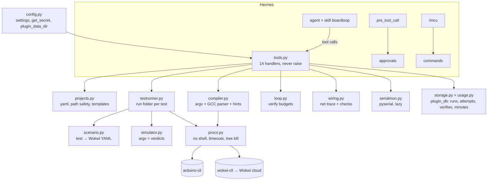

# Architecture

BoardLoop is a native Hermes plugin (`plugin.yaml` + `register(ctx)`). The repository root is the
plugin root. Pure-Python logic is separated from subprocess calls and from Hermes, so almost all of
it is unit-tested without network, tools or Hermes.

## Modules

| Module | Responsibility | Talks to |
|---|---|---|
| `__init__.py` | `register(ctx)`: tools from the `TOOLS` table, the hook, `/mcu`, the skill | Hermes |
| `tools.py` | Argument validation, orchestration, JSON results, token redaction, minutes in results | all modules |
| `config.py` | Settings (validated, clamped), tool discovery, the only Hermes service imports (lazy) | Hermes |
| `procs.py` | `run(argv)`: `shell=False`, timeouts, process-group kill, 200 KB output cap | OS |
| `projects.py` | `boardloop.yaml` model and validation, path safety, templates, parts and wiring tables | files |
| `compiler.py` | Compile argv, GCC error parser, hints, size summary, failure classification | procs |
| `scenario.py` | Pure: test → Wokwi scenario YAML, timeout budget | – |
| `simulator.py` | wokwi-cli argv, run classification into human-readable reasons | – |
| `testrunner.py` | Stages one isolated run folder per test (patched diagram, firmware, scenario), runs, records | procs, storage |
| `loop.py` | `mcu_verify` state machine and budgets, failure suggestions | wiring, storage |
| `wiring.py` | Net tracing through wires and resistors; wiring rules | – |
| `serialmon.py` | Bounded serial read/write; expectation check | pyserial |
| `storage.py`, `usage.py` | SQLite tables; rolling 30-day Wokwi minutes | plugin_db |
| `approvals.py` | `pre_tool_call` → approval for `mcu_upload`, `mcu_serial_write` | Hermes |
| `commands.py` | `/mcu` text output | tools |

## Data flow of one `mcu_test`

1. `projects.load` validates `boardloop.yaml` and checks every part id against `diagram.json`.
2. For each test, `testrunner.stage` creates `runs/<project>/<run-id>/<test-slug>/` with
   `wokwi.toml`, the firmware files it references, a `diagram.json` with the test's sensor attrs
   patched in, and `scenario.yaml` from `scenario.build`.
3. `procs.run` starts `wokwi-cli <dir> --scenario scenario.yaml --timeout <budget> --fail-text …
   --serial-log-file …` with the token only in the child's environment.
4. `simulator.classify` maps the exit code and output to a verdict:
   `expected led1:A = 1, got 0`, `expected serial 'LED=ON' not seen`, `fail text seen: …`.
5. The run (simulated ms, verdict) goes to `storage`; the summary is saved for `/mcu`.

## Storage (`plugin_db("boardloop")`)

`runs(id, project, kind, started_ts, sim_ms, passed, reason)`,
`attempts(project, stage, count)`, `verifies(project, ts, status, summary)`,
`latest(project, kind, ts, data)`. Wokwi minutes = `SUM(sim_ms)` of simulate/test runs over 30 days.

## Formats verified against the real tools

Wokwi scenario keys, exit codes and messages were read from the wokwi-cli source and then
recorded from real runs (`tests/fixtures/wokwi/NOTES.md`). arduino-cli JSON output
(`--format json`) and GCC error lines are parsed defensively for both 1.x and older layouts.
