<p align="center">
  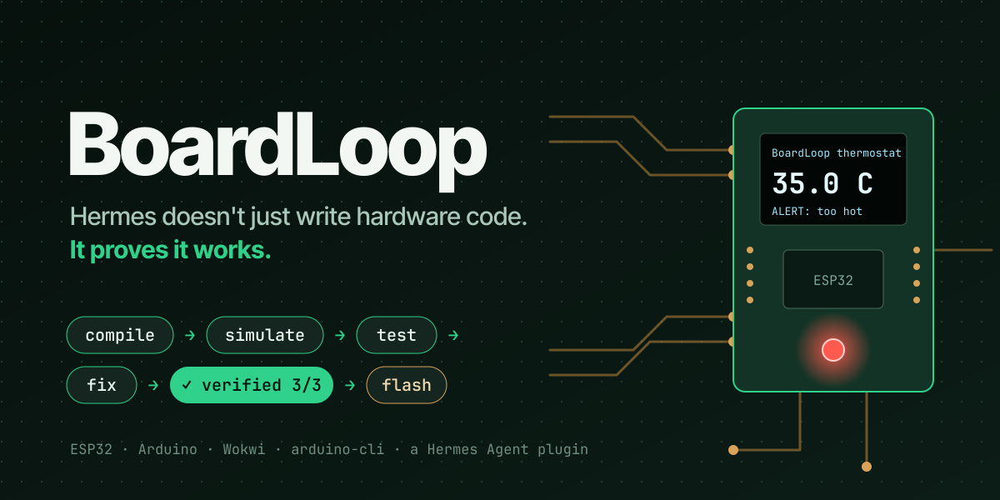
</p>

## What does this PR do?

Adds `plugin-catalog/boardloop.yaml`, the catalog entry for **[BoardLoop](https://github.com/LSUDOKO/BoardLoop)**. I'm submitting it as the plugin repository's owner, for the Hermes Agent Plugin Hackathon.

BoardLoop gives Hermes a real embedded toolchain and a simulated workbench, so it can **prove** the ESP32 and Arduino firmware it writes actually works:

1. **Compile** with the user's `arduino-cli`. Hermes gets at most 10 parsed errors, each with source context and a fix hint.
2. **Simulate** on [Wokwi](https://wokwi.com). Each test in `boardloop.yaml` sets sensor values, presses buttons, and checks serial output and pins. It can also save an OLED screenshot.
3. **Fix** within bounded budgets: 3 compile fixes and 5 behaviour fixes, the same budgets as the EmbedGenius loop. A run ends `verified` or `needs_human`, never in an endless loop.
4. **Flash a real board** only through Hermes's approval prompt. Then read its serial output to confirm.

Research context: the best model passes only 55.6% of embedded tasks without hardware feedback (EmbedAgent, ICSE 2026). With a compile → test → fix loop, accuracy reaches 95.7% (EmbedGenius, arXiv 2412.09058).

| | |
|---|---|
| **Demo on X (86 s)** | **https://x.com/_arpit1/status/2120135607280439781**: the hackathon demo, one real Hermes run |
| **Demo video (2:27)** | **https://youtu.be/rmpxsMKtOE4**: every feature step by step, real Hermes sessions next to the same firmware running on Wokwi |
| Repo | https://github.com/LSUDOKO/BoardLoop, pinned at [`2bbe65c`](https://github.com/LSUDOKO/BoardLoop/tree/2bbe65cfa46281d293c6e94c762449862cb7a0fb) (plugin version 0.2.2, [release notes](https://github.com/LSUDOKO/BoardLoop/releases/tag/v0.2.2)) |
| Website | https://boardloop.pages.dev |
| Reviewer guide | [`docs/EVALUATION.md`](https://github.com/LSUDOKO/BoardLoop/blob/2bbe65cfa46281d293c6e94c762449862cb7a0fb/docs/EVALUATION.md): every claim mapped to the code and test that backs it |

[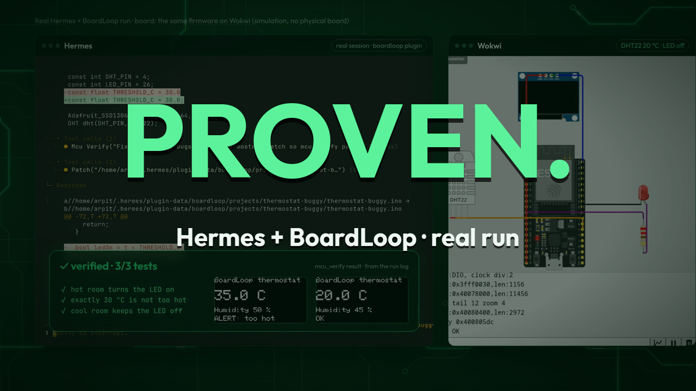](https://youtu.be/rmpxsMKtOE4)

## Proof from a real run

All six frames come from **one unedited Hermes session** (Hermes 0.23.0, `longcat-2.5:free`), and every result is read from that run's folder. The prompt was: *"The thermostat-buggy project is broken. Create it from the demo-thermostat-buggy template, then run mcu_verify first, fix only what it reports, and run mcu_verify again after each fix until it is verified."* The sketch has two planted bugs: a missing `;`, and a reversed comparison.

| 1. `mcu_verify`: arduino-cli fails with 4 errors | 2. Hermes adds the missing `;` |
|---|---|
| 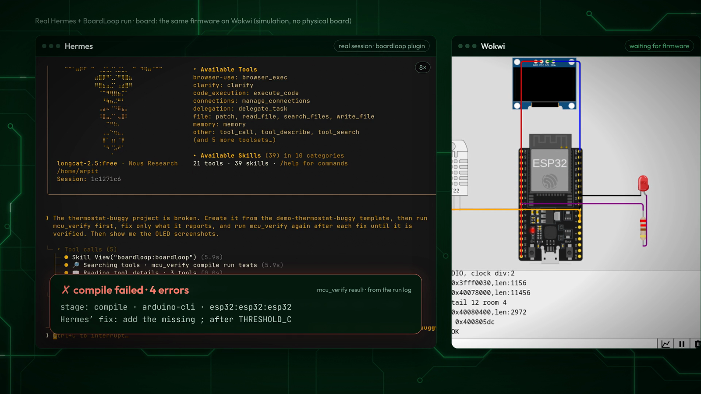 | 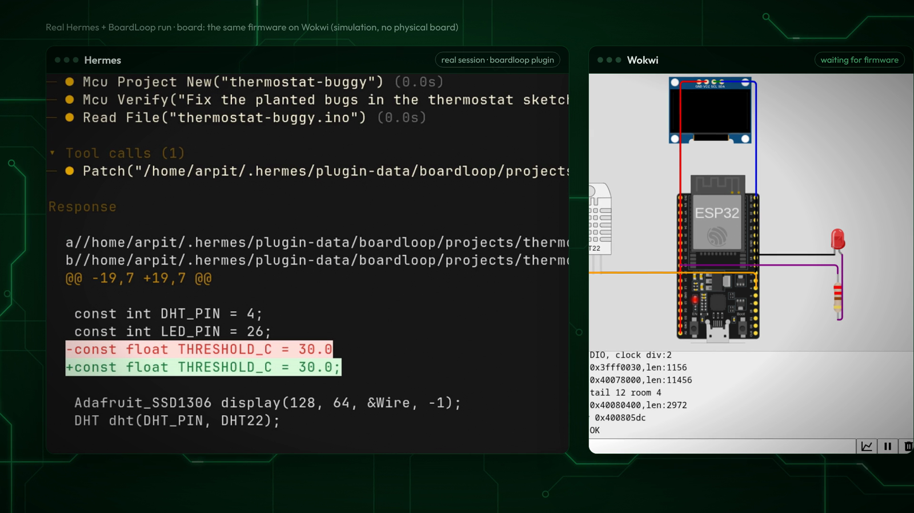 |
| **3. It compiles, but the hot-room test fails:** DHT22 set to 35 °C, `expected serial 'LED=ON' not seen`, serial `T=35.0 H=50.0 LED=OFF` | **4. Hermes reads the serial log and flips `<` to `>`** |
| 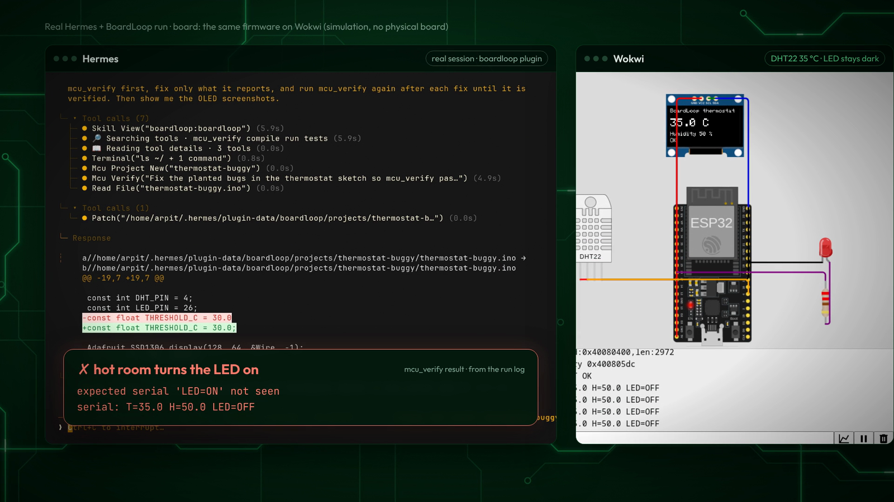 | 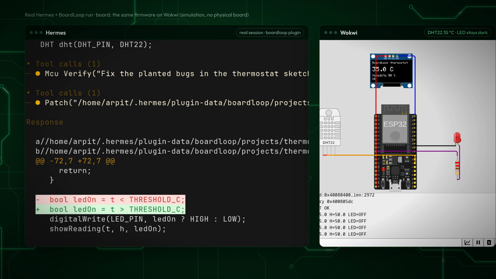 |
| **5. Verified 3/3** (hot, cool, and the exactly-30 °C edge case), with the OLED screenshots the run saved | **6. `mcu_upload` stops at Hermes's approval prompt.** It shows firmware size and test status. No board was connected and nothing was flashed. |
| 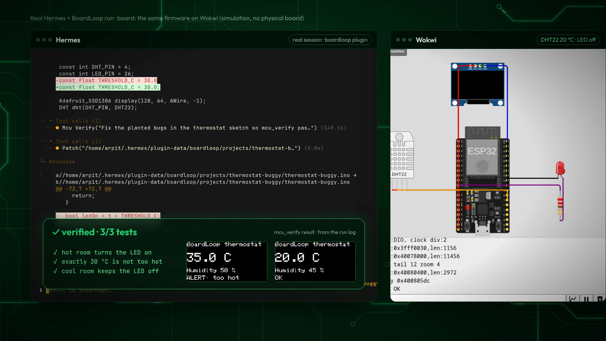 | 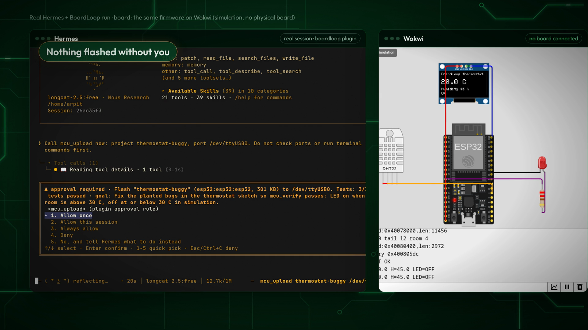 |

The rest of the toolset, from the same Hermes install:

| `/mcu doctor` (token shown only as "set") | `mcu_project_info` (parts and pins) | `/mcu` Wokwi minutes meter |
|---|---|---|
| 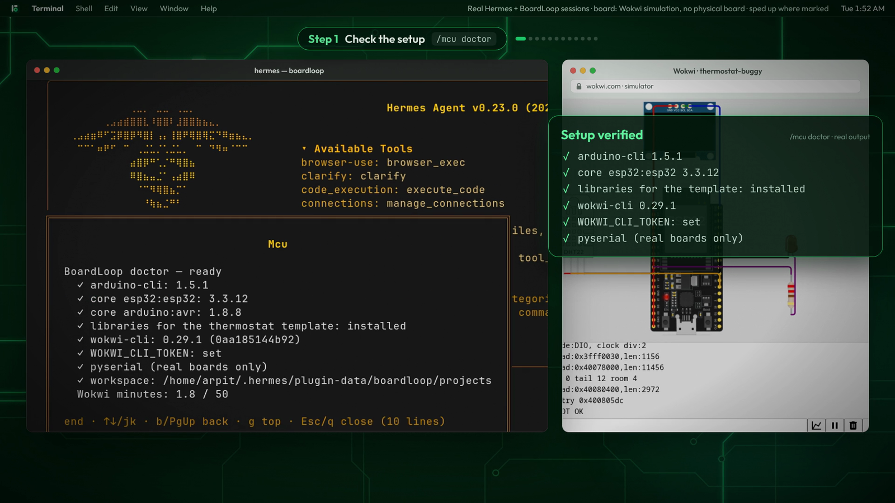 | 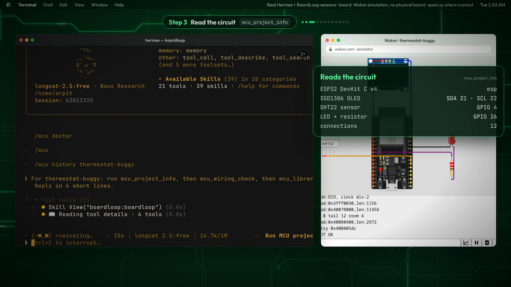 | 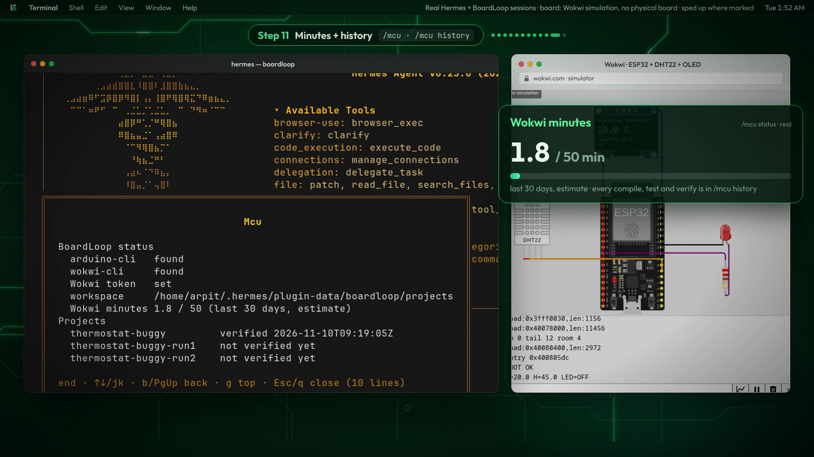 |

## Related Issue

None. This adds a new catalog entry.

## Type of Change

- [x] ✨ New feature (non-breaking change that adds functionality)

## Changes Made

- `plugin-catalog/boardloop.yaml`: the new entry. It is pinned to the full 40-character SHA `2bbe65cfa46281d293c6e94c762449862cb7a0fb`, with the disclosure in `description`. Its `capabilities` match what `register()` declares at that commit: 14 tools and the `pre_tool_call` hook. `requires_hermes: ">=0.23.0"`, the same floor as `plugin.yaml`. `version: "0.2.2"`. Every image and docs URL is pinned to the same SHA.

### Hermes surfaces used (public APIs only)

- **Tools:** `register_tool`, toolset `boardloop`, 14 tools:
  - `mcu_doctor`, `mcu_project_new`, `mcu_project_info`, `mcu_libraries`, `mcu_wiring_check`
  - `mcu_compile`, `mcu_simulate`, `mcu_test`, `mcu_verify`, `mcu_export`
  - `mcu_ports`, `mcu_upload`, `mcu_serial_read`, `mcu_serial_write`
- **Approval hook:** `pre_tool_call` escalates `mcu_upload`, `mcu_serial_write` and `mcu_test target="real"` (which flashes first) to Hermes's approval prompt. It only escalates; there is no auto-approve path. When nobody is there to answer, Hermes refuses the call.
- **Command and skill:** `register_command("mcu")` (status, projects, history, doctor) and `register_skill("boardloop")`.
- **Settings and storage:** `config_schema`. The Wokwi CI token is a `secret`, read with `agent.secret_scope.get_secret()` and passed only to `wokwi-cli`. Run history lives in `plugin_db`, files in the plugin data dir.
- **Desktop:** `desktop/plugin.js` adds a Workbench pane and a tool-media card for its own tools' screenshots, using SDK slots only.
- **Dashboard:** `dashboard/plugin_api.py` serves read-only routes over the plugin's own data folder and sends a `results.updated` plugin event.

### Disclosures

- **Subprocesses:** runs the user-installed `arduino-cli` and `wokwi-cli` with fixed argument lists, `shell=False`, timeouts on every call, and a process-group kill on timeout.
- **Cloud upload:** `wokwi-cli` sends the compiled firmware and the circuit diagram to Wokwi's cloud, using the user's token and the simulation minutes on their plan. Every run is metered and shown in `/mcu`.
- **Downloads:** `arduino-cli` may download cores and libraries when the user asks.
- **Real hardware:** flashing and serial writes to a real board always go through Hermes's approval prompt. `pyserial` is imported only when a real board is used.
- **Local data:** projects, run folders, screenshots and history stay in the plugin data dir. Project paths are confined to the workspace (no `..`, no escaping symlinks).
- **Privacy:** no telemetry.
- **Dependencies:** `pyyaml>=6.0,<7` and `pyserial>=3.5,<4`.

## How to Test

1. `python3 scripts/validate_plugin_catalog.py plugin-catalog/boardloop.yaml` prints `OK: 1 file(s) valid`.
2. At the pinned commit, `hermes plugins validate . --install-deps` passes. Output is under Screenshots / Logs below.
3. At the pinned commit, `hermes plugins doctor . --ci` passes: `boardloop 0.2.2`, 14 tools and 1 hook registered.
4. Without network or toolchain, `python -m pytest -q` gives 187 passed and 3 skipped. The skipped ones are the real-toolchain tests, which run with `BOARDLOOP_REAL=1`. The desktop tests (`node --test`) give 4 passed. CI runs both on Ubuntu and macOS with Python 3.11 and 3.13.
5. End to end:
   - `hermes plugins install boardloop`
   - set the Wokwi token with `hermes config set WOKWI_CLI_TOKEN …` and run `/mcu doctor`
   - ask: *"Create thermostat-buggy from the demo-thermostat-buggy template and make it pass its tests."*

## Checklist

- [x] I searched existing PRs; there is no other BoardLoop entry
- [x] This PR contains only the catalog entry
- [x] Exact 40-character SHA pin; `capabilities` match `register()`; `requires_hermes` floor set in both places
- [x] No binaries, bytecode or archives in the plugin repo (`scripts/check_repo.py` runs in its CI)
- [x] Secrets only through `get_secret`; no `.env` or `auth.json` reads; approvals never bypassed
- [x] Risky behaviour disclosed above and in the plugin README (*Privacy, safety and disclosures*)
- [x] Tested on Arch Linux (Hermes 0.23.0); plugin CI covers Ubuntu and macOS

## Screenshots / Logs

<details>
<summary><code>hermes plugins validate . --install-deps</code> at 2bbe65c</summary>

```
✓ manifest — plugin.yaml parses
✓ manifest fields — name, version, description present
✓ requires_hermes — spec '>=0.23.0' parses
✓ config schema — shape valid
✓ requires_env — all entries UPPER_SNAKE
✓ oauth — not declared
✓ loadable — entry: __init__.py, desktop/plugin.js
✓ python dependencies — 2 requirements from manifest
✓ capability probe — register() ran in isolation
✓ declared tools — matches registrations
✓ declared hooks — matches registrations
✓ declared middleware — matches registrations
✓ built-in tool collisions — no collisions
✓ security scan — safe
✓ no core override — no runtime rebinds of Hermes core
✓ desktop surface — stays inside the plugin SDK surface
⚠ private core imports (catalog rule 9: public surfaces only; these can break on
any release): scripts/hermes_e2e.py:38 hermes_cli.plugins.discover_plugins;
scripts/hermes_e2e.py:40 model_tools.handle_function_call;
scripts/hermes_e2e.py:38 hermes_cli.plugins.get_plugin_manager.
◆ Isolation — runs in the plugin host (plugins.isolation: host)
  · dashboard backend API is served through the plugin host (buffered responses)
Validation passed.
```

The one warning comes from `scripts/hermes_e2e.py`. It is a dev-only script, never loaded by the plugin: it drives Hermes's own dispatcher in a throwaway `HERMES_HOME` for end-to-end checks. The plugin's runtime code uses only documented surfaces.
</details>

<details>
<summary><code>hermes plugins doctor . --ci</code> at 2bbe65c</summary>

```
Plugin Doctor: BoardLoop
  manifest: boardloop 0.2.2 (standalone)
  OK: runtime discovery, manifest parsing, import, and registration passed
  registrations: 14 tool(s), 1 hook(s)
```
</details>
